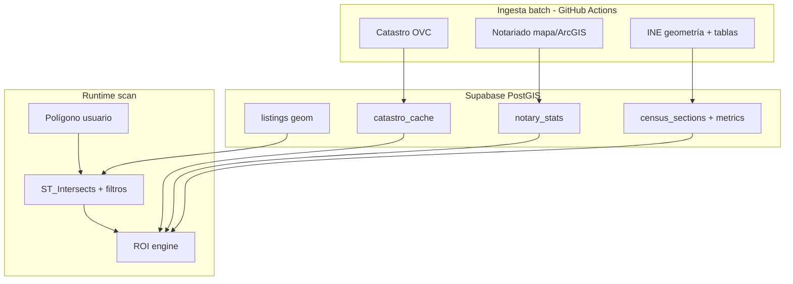
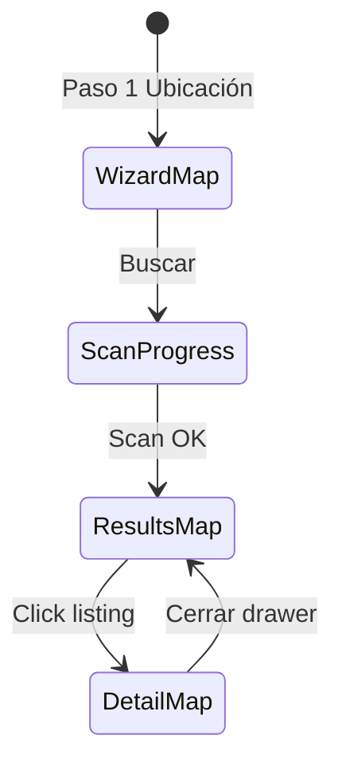

# Análisis: datos oficiales, cobertura de pisos y mapas

> Complemento estratégico de `MEGAPROMPT.md`.  
> Objetivo: definir **cómo** conectar Catastro, Notariado e INE; **cómo** maximizar oportunidades visibles sin pagar APIs; y **cómo** diseñar el núcleo mapa + scan geoespacial.

---

## 1. Principio rector del producto

Hay dos productos distintos mal mezclados en el mercado:

| Enfoque | Qué optimiza | Nuestro caso |
|---------|--------------|--------------|
| Portal inmobiliario | Cobertura total del mercado | **No** |
| Radar de inversión | Señal / ROI / comparables | **Sí** |

**Tesis:** el inversor no quiere 4.000 cards; quiere **40–120 operaciones defendibles** en su polígono, ordenadas por ROI, con trazabilidad (comparables + notariado + barrio).

Eso permite vivir con **menos listings almacenados** pero **mejor enriquecidos**, dentro del free tier de Supabase (500 MB).

---

## 2. Las tres fuentes oficiales — arquitectura de conexión

Patrón común para las tres: **ETL en GitHub Actions → tablas cache en PostGIS → lectura en scan/API**.  
Nunca llamar a Catastro/INE/Notariado en cada click del usuario (límites, latencia, caídas).



### 2.1 Catastro ([sedecatastro.gob.es](https://www.sedecatastro.gob.es))

**Qué aporta al inversor**

- Referencia catastral (RC), superficie construida, antigüedad, uso.
- Validación “¿el m² del anuncio encaja con catastro?” (flag overstatement).
- Base para **IBI estimado** en calculadora (% sobre valor/cadastro).
- Capa WMS de parcelas (contexto visual, no descarga masiva).

**Cómo conectar (0 €)**

| Paso | Acción |
|------|--------|
| Geocode listing | Si lat/lng del scraper → `Consulta_RCCOOR` (JSON REST) |
| Detalle inmueble | `Consulta_DNPRC` / callejero JSON por RC 14–20 chars |
| Valoración manual | Usuario introduce dirección o RC → mismo flujo |
| Mapa | WMS Catastro como capa opcional “Parcelas” (GetMap + GetFeatureInfo puntual) |

**Endpoints de referencia**

- Coordenadas → RC: `http://ovc.catastro.meh.es/OVCServWeb/OVCWcfCallejero/COVCCoordenadas.svc/json/Consulta_RCCOOR?CoorX={lon}&CoorY={lat}&SRS=EPSG:4326`
- RC → datos: servicios documentados en [Webservices_Libres.pdf](https://www.catastro.hacienda.gob.es/ws/Webservices_Libres.pdf)
- WMS: `http://ovc.catastro.meh.es/Cartografia/WMS/ServidorWMS.aspx`

**Reglas operativas**

- Cache obligatoria (`catastro_cache`: key = RC o grid 25 m).
- Throttle **≤ 1 req/s** en jobs; batch nocturno para listings sin RC.
- No bulk WFS parcelas de toda España (prohibido / inviable en free tier).

**Cábala C1:** el 30–50 % de anuncios tendrán geolocalización imprecisa (portal). Estrategia: RC por coordenada + si falla, RC por dirección normalizada (calle + número + municipio) vía `Consulta_DNPLOC`.

---

### 2.2 Notariado ([penotariado.com](https://www.penotariado.com))

**Qué aporta**

- Precio **real** de compraventas (no asking price).
- Por CCAA, provincia, municipio, **código postal**, y en el visor por área dibujada.
- Campos típicos: `precio_m2`, `precio_medio`, `superficie_media`, `total_informados` / operaciones.

**Cómo conectar (0 €)**

El portal público usa un **mapa ArcGIS** con capas agregadas (Feature Service). No hay documentación REST “oficial” tan limpia como Catastro, pero el servicio es el que alimenta el “housing price finder”.

**Estrategia MVP (recomendada)**

1. **Precarga por CP** de ciudades piloto: job semanal que consulta el Feature Service por `locationType=CP` (códigos 08001…08042, 28001…, etc.).
2. Guardar en `notary_stats(postal_code, period, precio_m2, precio_medio, superficie_media, operations, es_estimado, raw jsonb)`.
3. En scan: join listing → CP → fila notariado más reciente.
4. UI: bloque “Mercado notarial (CP 08003)” + badge **“Anuncio vs mercado”** (% sobre/bajo precio m² notarial).

**Estrategia scan polígono (como ROI Explorer)**

- Calcular **CP dominante** dentro del polígono (intersección área listing vs centroides CP) o media ponderada de CPs intersectados.
- Para “análisis de zona”: agregar stats de todos los CP del polígono.

**Riesgos**

- Muestra mínima: CP con pocas operaciones → `precio_m2` null (mostrar “dato insuficiente”, no inventar).
- URL del Feature Service puede cambiar → job debe **descubrir** `webmapId` / layer id del front (versionar en repo cuando se detecte rotura).

**Cábala N1:** el Notariado es tu **ancla de credibilidad** frente a portales; el ROI de alquiler es modelo, pero el precio de compra se contrasta con **ventas reales**.

**Cábala N2:** registrar cuenta gratuita en el portal puede desbloquear descargas; valorar solo si el scraping del mapa falla repetidamente.

---

### 2.3 INE ([ine.es](https://www.ine.es))

**Dos capas distintas**

| Capa | Uso en mapa/producto | Fuente |
|------|----------------------|--------|
| **Geometría** secciones censales | Toggle “Secciones censales”, colorear por métrica | OGC API Features `Secciones_2024`, shapefile [cartografía INE](https://www.ine.es/prodyser/cartografia), [datos.gob.es](https://datos.gob.es/es/catalogo/ea0042823-cartografia-digitalizada-de-secciones-censales) |
| **Atributos** demográficos/económicos | Panel Barrio: renta, empleo, educación, Gini | INEbase tablas “por secciones censales” vía [API JSON](https://www.ine.es/dyngs/DAB/index.htm) / [OpenAPI](https://ine.es/OpenAPI/) |

**Cómo conectar geometría (0 €)**

**Opción A — Híbrida (recomendada para MVP)**

- **Una vez** por provincia piloto: descargar shapefile/GeoJSON de secciones (Actions, manual si falla API).
- Import a `census_sections(cusec, geom, prov, mun, props jsonb)` en PostGIS (EPSG:4326 o 25830 + transform).
- En app: servir GeoJSON **solo del bbox** del viewport (API route con `ST_Intersects(geom, bbox)` + límite 500 features).

**Opción B — Proxy en vivo**

- Cliente pide bbox → servidor llama OGC API INE con bbox.  
- **Contras:** dependencia uptime INE (p.ej. incidencias 500), más lento.  
- Usar como fallback, no como única vía.

**Cómo conectar atributos**

1. Identificar tablas INEbase con dimensión **sección censal** (Cusec / CLAU).
2. Job mensual: descargar CSV/JSON por provincia → `census_section_metrics(cusec, year, metrics jsonb)`.
3. Join: `listing.geom` → `ST_Contains(section.geom)` → métricas.

**Atribución legal (obligatoria INE):** *«Seccionado cedido por el Instituto Nacional de Estadística»* (CC BY 4.0).

**Cábala I1:** el toggle “Secciones censales” no necesita pintar toda España — solo **vector tiles simplificados** o GeoJSON clip del bbox; simplificar geometrías (ST_Simplify) para MapLibre.

**Cábala I2:** renta per cápita por sección puede ir **1–2 años desfasada**; mostrar año del dato en UI.

---

## 3. Máximo de pisos “disponibles” sin volverse Idealista

### 3.1 Objetivo realista de cobertura

| Escala | Venta (oportunidades) | Alquiler (comparables) | Notas |
|--------|------------------------|-------------------------|-------|
| 1 ciudad piloto | 2.000–8.000 activos | 3.000–15.000 activos | Depende portales y profundidad scrape |
| Scan típico barrio | 20–150 **mostrados** | 50–400 en radio | Tras filtros + top N ROI |
| Supabase free | ~50k–150k filas listings **si** slim schema | | Imágenes solo URL externa |

El **mapa** debe sentirse nacional (pan por toda España); la **profundidad** de anuncios crece por fases (ciudades → provincias → bajo demanda). Ver `MAPA-ESPANA.md`.

### 3.2 Palancas para maximizar señal (orden de impacto)

1. **Multi-portal venta** (**Kelify + pisos.com** P0; Fotocasa + habitaclia P1) con **deduplicación**  
   - Clave: `(normalized_address, m2±5%, price±3%)` o mismo edificio RC catastro.
2. **Scrape por rejilla H3 o cuadrícula 500 m** en ciudad piloto (no solo “primera página búsqueda”).  
   - Actions: un workflow por casilla + merge.
3. **Re-scrape incremental** cada 6–12 h: actualizar precio, bajadas (badge ↓ 5 % como ROI Explorer).
4. **Alquiler en la misma BD** solo para comparables (no hace falta UI pública de alquiler).
5. **Precomputar `listing_investment`** (rent_est, roi_gross, confidence) en batch → scan instantáneo en polígono.

### 3.3 Qué NO hacer (coste / legal / DB)

- No guardar 20 fotos por piso en Storage (solo `thumbnail_url` proxy).
- No scrapear todo el país día 1.
- No mostrar listings sin coordenadas: **cola de geocode** (Nominatim OSM con cache + Catastro).

### 3.4 Fórmula de “máximo útil” en un scan

```
candidatos = listings_venta WHERE ST_Within(geom, polygon) AND filtros
con_renta  = candidatos JOIN estimación alquiler (comparables en 250–500 m)
ranked     = ORDER BY roi_gross DESC, confidence DESC
mostrados  = TOP 100 (configurable)
```

Listings con ROI no calculable van a pestaña secundaria “Sin estimación” (opcional), no al mapa principal.

**Cábala L1:** con **5.000 ventas + 8.000 alquileres** en Barcelona bien geolocalizados, la experiencia ya compite con demos de ROI Explorer en barrios densos.

**Cábala L2:** la ventaja no es el número total sino **% con ROI + comparables ≥ 3** en la zona dibujada.

---

## 4. Mapas — diseño fundamental

El mapa no es decoración: es el **motor de selección espacial** del scan.

### 4.1 Stack mapa (0 €)

| Pieza | Elección |
|-------|----------|
| Render | **MapLibre GL JS** |
| Basemap | OpenStreetMap (p.ej. `https://tile.openstreetmap.org/{z}/{x}/{y}.png`) — respetar [policy de uso](https://operations.osmfoundation.org/policies/tiles/) o mirror propio más adelante |
| Dibujo polígono | `@mapbox/mapbox-gl-draw` (BSD) o Terra Draw |
| Proyección | WGS84 (EPSG:4326) en app; transform en DB si hace falta |
| Backend espacial | **PostGIS** `geometry(Point,4326)`, `geometry(Polygon,4326)` |

### 4.2 Tres modos de mapa en la app



| Modo | Interacción | Datos |
|------|-------------|-------|
| **Wizard** | Dibujar polígono + buscar ciudad | OSM + opcional límite municipal (GeoJSON INE municipios, fase 2) |
| **Resultados** | Pins ROI %, sync lista↔mapa, hover highlight | `scan_results` + cluster si >200 puntos |
| **Detalle** | Mini-mapa comparables (círculo 250 m) | Points alquiler + centro venta |

### 4.3 Consultas PostGIS críticas

**Listings en polígono**

```sql
SELECT l.*, li.roi_gross
FROM listings l
JOIN listing_investment li ON li.listing_id = l.id
WHERE l.operation = 'sale'
  AND l.status = 'active'
  AND ST_Within(l.geom, ST_SetSRID(:polygon, 4326))
ORDER BY li.roi_gross DESC NULLS LAST
LIMIT 100;
```

**Índices obligatorios**

- `GIST (geom)` en listings, census_sections  
- `(operation, status)` parcial  
- `scan_results(scan_id, rank)`

**Cábala M1:** para 100 pins, **no uses clustering**; para >300 en zoom bajo, cluster MapLibre `supercluster` en cliente con GeoJSON de un solo fetch.

**Cábala M2:** el polígono del usuario se guarda en `scans.geom` — “Repetir scan” = mismo geom, re-ejecutar pipeline con datos frescos.

### 4.4 Capas overlay (prioridad)

1. **Pins ROI** (principal)  
2. **Secciones censales** (toggle) — GeoJSON bbox, estilo fill opacity 0.15, color por cuantil renta  
3. **Catastro WMS** (toggle avanzado, fase 2) — parcelas solo zoom ≥ 16  
4. **Heatmap ROI** (fase 3) — solo analytics, no MVP

### 4.5 Sync lista ↔ mapa (UX ROI Explorer)

- Un solo `selectedListingId` en estado URL (`?id=...`).
- Hover card → `map.setFeatureState` resalta pin.
- Click pin → scroll lista + abre drawer.
- Orden ROI ↓ compartido entre lista y capa pins (mismo array ordenado).

### 4.6 Límites Vercel y scan “~35 s”

El progreso en UI (desarrollos / anuncios / ROI) puede ser **fases reales** o **fases simuladas** mientras corre un job:

| Enfoque | Cuándo |
|---------|--------|
| **Sync** | Precomputado `listing_investment` → scan <3 s |
| **Async** | Scan crea `scans.status=processing` → Action/queue chunk → Resend al terminar |

**Recomendación:** MVP Barcelona con precompute → scan percibido instantáneo; async solo si polígono enorme.

---

## 5. Pipeline unificado de un scan (secuencia)

1. Usuario cierra polígono en wizard → `POST /api/scans` guarda geom + filtros.  
2. Servidor cuenta candidatos (`ST_Within`).  
3. Filtra operación (buy-to-let / habitaciones / airbnb ajusta modelo renta).  
4. Para cada candidato (o solo top 200 preliminares por precio/m²):  
   - Buscar comparables alquiler en radio (PostGIS `ST_DWithin`).  
   - Mediana × 0.85 → renta.  
   - ROI engine.  
   - Adjuntar CP → notary_stats.  
   - Adjuntar sección censal → metrics.  
5. Persistir `scan_results`, `status=done`.  
6. Cliente polling o Realtime Supabase `scans` row.

**Enriquecimiento Catastro** puede ser **async** (no bloquear scan): ficha muestra “Catastro pendiente” hasta job nocturno.

---

## 6. Cábalas resumidas (apuestas de diseño)

| ID | Apuesta | Si acierta | Si falla |
|----|---------|------------|----------|
| **H1** | Precomputar ROI en batch | Scan rápido, UX premium | Hay que invalidar al cambiar comparables |
| **H2** | Notariado por CP preloaded | Barrio creíble sin latencia | CP sin muestra → UI vacía (mitigar con municipio) |
| **H3** | INE shapefile local | Mapa estable sin depender API live | Repo/DB más pesados (solo provincias activas) |
| **H4** | Top 100 en polígono basta | Inversor satisfecho | Power users piden “ver todos” → export CSV |
| **H5** | MapLibre + OSM | 0 € | Estilo menos pulido que Mapbox — aceptable MVP |
| **H6** | Grid scrape por ciudad | Máxima cobertura local | Más minutos Actions — priorizar barrios ROI alto |

---

## 7. Próximos pasos documentales / técnicos

1. Fijar **ciudad piloto** y lista de **CP** para primer job Notariado.  
2. PoC Catastro: 10 coordenadas Barcelona → RC → superficie.  
3. PoC INE: import 1 municipio (08019 Barcelona) secciones + join 1 listing.  
4. Definir schema slim `listings` + `listing_investment`.  
5. Prototipo mapa wizard polígono (MapLibre) antes de scrapers masivos.

---

## 8. Referencias

- Catastro WS: https://www.catastro.hacienda.gob.es/ws/Webservices_Libres.pdf  
- INE OGC Features: https://www.ine.es/geoserver/ogc/features/v1/collections  
- INE API JSON: https://www.ine.es/dyngs/DAB/index.htm  
- Notariado: https://www.penotariado.com  
- OSM tile usage: https://operations.osmfoundation.org/policies/tiles/
