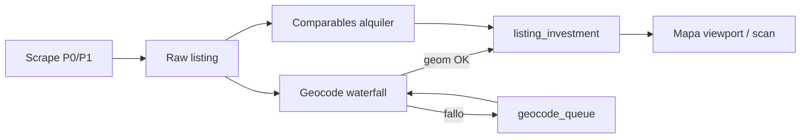

# Cómo intervenir en los cuellos de botella

> **Canón:** `MEGAPROMPT.md` **§5.1** (tabla B1–B12, DoD, schema, roadmap). Este archivo es detalle operativo.  
> **Stack:** Vercel + Supabase + GitHub Actions, sin VPS.

---

## Visión del pipeline (todo listing pasa por aquí)



**Regla:** solo entra al mapa principal si `geom IS NOT NULL` y `geocode_quality >= threshold` (salvo zoom bajo con pin “aproximado”).

---

## 1. Cobertura (tener pisos en Valencia, Sevilla, …)

### 1.1 Qué significa “cobertura”

| Métrica | Definición |
|---------|------------|
| **Región cubierta** | Municipio/provincia con ≥ N ventas activas `< 7 días` |
| **Densidad mapa** | En bbox típico ciudad, viewport zoom 12 devuelve ≥ 20 pins |
| **Freshness** | `scraped_at` medio < 48 h en regiones activas |

### 1.2 Estrategia de scrape (sin VPS)

**Orden de fuentes por URL (más barato primero):**

1. **Sitemap / feeds XML** del portal (si existen) → lista de IDs → detalle por `fetch`.
2. **Búsqueda por ciudad** (pisos.com slugs: `valencia`, `sevilla`, …) paginada con límite `MAX_LISTINGS` por run.
3. **Rejilla H3** sobre bbox del municipio (resolución **7 u 8**) — cada hex → búsqueda mapa/URL con coords centroide; si el portal capa resultados (~200), **subdividir** hex (res+1). Librería: `h3-js` en Actions.

**Plan España (Actions, 0 €):**

| Job | Frecuencia | Alcance |
|-----|------------|---------|
| `scrape-tier1-cities.yml` | 2×/día | 8 ciudades: Madrid, Barcelona, Valencia, Sevilla, Málaga, Bilbao, Zaragoza, Murcia |
| `scrape-tier2-cities.yml` | 1×/día | 25 capitales provincia restantes (rotación) |
| `scrape-province-rotate.yml` | 1 provincia/noche | 52 provincias, ciclo ~2 meses |
| `scrape-on-demand.yml` | manual / webhook | bbox desde `user_map_requests` |

Archivo config: `scripts/scrape/spain-locations.json` (slug portal, bbox, priority).

**Kelify + pisos.com en paralelo** por ciudad; dedup cross-portal (§3 doc).

### 1.3 Tablas de control

```sql
-- coverage_regions: para leyenda mapa y priorizar scrapers
coverage_regions (
  id, kind,           -- 'city' | 'province'
  code, name, bbox,
  sale_count, rent_count,
  last_scrape_at, next_scrape_priority
);

-- peticiones usuarios en zonas vacías
user_map_requests (
  user_id, bbox, created_at, fulfilled_at
);
```

### 1.4 Intervenciones concretas

- [ ] Definir **Tier 1** y lanzar scrapers solo venta+alquiler ahí hasta ≥2k ventas/ciudad.
- [ ] Tras cada job: `REFRESH` contadores en `coverage_regions`.
- [ ] Mapa: capa “**Zonas con datos**” (polígono suave o lista en panel).
- [ ] Botón “**Solicitar datos en esta zona**” → insert `user_map_requests` + label “En cola (~24–48 h)”.

**Realismo free tier:** 8 ciudades bien cubiertas **antes** de prometer pins en pueblo de 5.000 hab. La UI nacional sí; la densidad crece por fases.

---

## 2. Coordenadas (sin geom no hay pin)

### 2.1 Waterfall de geocodificación (orden fijo)

| Paso | Método | Calidad | Coste |
|------|--------|---------|-------|
| **G0** | Lat/lng en JSON/HTML del portal | A (ideal) | 0 |
| **G1** | Parseo mapa embebido / `data-lat` en scrape | A | 0 |
| **G2** | **Catastro** `Consulta_DNPLOC` (prov, mun, calle, número) | A–B | 0, cache 30 d |
| **G3** | **Catastro** `Consulta_RCCOOR` si ya hay coords aprox | B | 0 |
| **G4** | **Nominatim** public (1 req/s, User-Agent `PlataformaInversion/1.0`) | B–C | 0, **cache obligatorio** |
| **G5** | Centroide **municipio** (INE/OSM) | D | 0 — badge “ubicación aproximada”, ocultar si zoom ≥ 14 |

**Política Nominatim:** no geocodificar 10k filas en un run. Job `geocode-batch.yml`: **max 200/run**, 1,1 s entre requests, solo filas sin cache. [Política OSM](https://operations.osmfoundation.org/policies/nominatim/).

### 2.2 Modelo de datos

```sql
listings (
  ...
  geom geography(POINT, 4326),
  geocode_quality smallint,  -- 1=A .. 5=D
  geocode_source text,       -- portal|catastro|nominatim|municipality
  address_normalized text,
  geocode_attempts smallint default 0
);

geocode_cache (
  key text primary key,      -- hash dirección normalizada
  geom, raw jsonb, source, created_at
);
```

Índice: `GIST(geom)` WHERE status = 'active'.

### 2.3 Cola y jobs

- Trigger: insert/update listing sin geom → fila en `geocode_pending(listing_id)`.
- **GitHub Action** cada hora: procesa cola (200 max), waterfall G2→G4.
- **Métrica dashboard:** `% listings con geocode_quality <= 3` por `city`.

### 2.4 Intervenciones concretas

- [ ] Normalizador dirección ES (quitar “piso”, “bajo”, unificar “Av.” / “Avenida”).
- [ ] Tabla `geocode_cache` antes de llamar APIs externas.
- [ ] Scraper: **extraer coords en origen** (mayor ROI de ingeniería).
- [ ] No contar en KPI “cobertura” listings solo calidad D.

---

## 3. ROI (renta estimada + ranking)

### 3.1 Escalera de confianza (renta mensual)

| Nivel | Método | Confianza UI |
|-------|--------|--------------|
| **R3** | ≥5 comparables alquiler en **250 m** (PostGIS `ST_DWithin`), mediana × **0,85** | Alta |
| **R2** | 3–4 comparables en **500 m** | Media |
| **R1** | Mediana alquiler misma **zone_key** (barrio/ciudad slug) | Media-baja |
| **R0** | Heurística **€/m²/mes** por ciudad (tabla `rent_benchmarks` actualizada semanalmente desde tus alquileres scrapeados) | Baja |
| **R-** | Sin dato → **no pin en mapa ROI** o pin gris “sin estimación” | — |

**No usar solo IRAV del INE** como renta absoluta: es índice **nacional mensual**, no €/mes por piso ([tabla 72975](https://www.ine.es/jaxiT3/Tabla.htm?t=72975)). Sirve para tendencia (“alquiler sube X%”), no para sustituir comparables.

### 3.2 Precompute (scan rápido)

Tabla `listing_investment`:

```sql
listing_investment (
  listing_id primary key,
  monthly_rent_est numeric,
  rent_confidence text,     -- high|medium|low|none
  comparables_count int,
  roi_gross numeric,
  roi_leveraged numeric,    -- nullable hasta calculadora
  zone_median_price_sqm numeric,
  vs_zone_pct numeric,
  computed_at timestamptz
);
```

**Job `precompute-roi.yml`** (post-scrape, Tier 1 ciudades):

1. Ventas activas sin `computed_at` stale.
2. Buscar comparables alquiler ( índice espacial ).
3. Calcular ROI bruto (ITP CCAA default 10 % hasta reglas finas).
4. Upsert `listing_investment`.

El **viewport map** lee `listing_investment` — no recalcula en Vercel por request (timeout).

### 3.3 Mejorar ROI sin más scrape

- Ajustar **ITP** por CCAA (tabla `tax_rules`).
- Incorporar **Notariado** `precio_m2` CP → flag “precio venta vs mercado”.
- Habitaciones / Airbnb: multiplicadores en `roi-engine` (fase 2).

### 3.4 Intervenciones concretas

- [ ] Scrape **alquiler** en las **mismas ciudades** que venta (mínimo Tier 1).
- [ ] Implementar R3→R0 en SQL o TS compartido + tests Valencia fixture.
- [ ] Badge en pin: color por `rent_confidence`.
- [ ] Recalcular batch nightly; invalidar si cambia precio venta > 2 %.

---

## 4. Objetivos medibles (Valencia / Sevilla)

| Objetivo | Meta MVP | Cómo medir |
|----------|---------|------------|
| Ventas activas ciudad | ≥ 800 | `COUNT` por `city` |
| Con geom calidad ≤3 | ≥ 85 % | SQL |
| Con ROI confianza ≥ media | ≥ 60 % | `listing_investment` |
| Viewport centro Valencia z=12 | ≥ 40 pins ROI | `/api/map/listings` manual test |

---

## 5. Orden de implementación recomendado

```
Semana A: geocode_cache + waterfall G0/G2 + geom en scraper
Semana B: Tier 1 scrape venta+alquiler + precompute R3-R0
Semana C: /api/map/listings + mapa España + coverage_regions
Semana D: Tier 2 ciudades + on-demand bbox queue
```

---

## 6. Referencias

- Nominatim usage: https://operations.osmfoundation.org/policies/nominatim/
- Catastro WS: https://www.catastro.hacienda.gob.es/ws/Webservices_Libres.pdf
- H3 (rejilla scrape): https://h3geo.org/
- INE IRAV (tendencia, no renta unitaria): https://www.ine.es/jaxiT3/Tabla.htm?t=72975
- Mapa producto: `MAPA-ESPANA.md`
